<!-- ================================================================ -->
<!--         Ganesh Yandigeri — Autonomous AI & Systems Engineer       -->
<!-- ================================================================ -->

<div align="center">

<h1 align="center">
  Hey there, I'm Ganesh
  
</h1>

<h3 align="center">
  ⚡ Autonomous Systems &nbsp;•&nbsp; Applied AI Engineer &nbsp;•&nbsp; High-Throughput Engines
</h3>

<p align="center">
  
</p>

<!-- ================================================================ -->
<!--                         [ SOCIAL MEDIA ]                         -->
<!-- ================================================================ -->

<p align="center">
  <code>[ SOCIAL MEDIA ]</code>
</p>

<p align="center">
  <a href="https://github.com/Gana-Y">
    
  </a>&nbsp;
  <a href="https://www.linkedin.com/in/ganesh-yandigeri-988821287">
    
  </a>&nbsp;
  <a href="https://x.com/Ganesh821060">
    
  </a>&nbsp;
  <a href="mailto:ganeshyandigeri1@gmail.com">
    
  </a>&nbsp;
  <a href="https://ganesh-portfolio-zjcx.vercel.app">
    
  </a>&nbsp;
  
</p>

<!-- ================================================================ -->
<!--                          SKILL PILLS                             -->
<!-- ================================================================ -->

<p align="center">
  &nbsp;
  &nbsp;
  &nbsp;
  &nbsp;
  &nbsp;
  &nbsp;
  &nbsp;
  &nbsp;
  &nbsp;
  &nbsp;
  
</p>

<!-- ================================================================ -->
<!--               ELECTRIC CYAN NEURAL NETWORK GRAPH                 -->
<!-- ================================================================ -->

<p align="center">
  
</p>

<p align="center">
  
  
  
  
  
</p>

</div>

---

<!-- ================================================================ -->
<!--             Personal ASCII / Braille Matrix Portrait             -->
<!-- ================================================================ -->

<div align="center">
  
</div>

---

## 👨‍💻 About Me

```python
class GaneshY:
    """
    Aspiring AI Engineer | Systems Architect | Problem Solver
    Location: Bangalore, India 🇮🇳 | Status: Building Production AI 🚀
    """
    def __init__(self):
        self.name      = "Ganesh Y"
        self.role      = "Applied AI & Systems Engineer"
        self.focus     = ["Multimodal RAG Pipelines", "High-Throughput Engines", "Distributed Systems"]
        self.grinding  = ["DSA daily (LeetCode) 💪", "OS • DBMS • Computer Networks • System Design"]
        self.stack     = ["Python", "PyTorch", "HuggingFace", "LangChain", "FastAPI", "PostgreSQL", "ChromaDB"]
        self.research  = ["LLM Quantization", "HNSW Vector Retrieval", "Sub-microsecond Matching Engines"]
        self.metrics   = {"cgpa": "9.35/10", "contributions": "1,200+", "production_tests": "555+ passing"}

    def ship_code(self):
        return "Transforming complex research into production-grade, sub-millisecond systems. ⚡"

me = GaneshY()
print(me.ship_code())
```

---

## 🚀 Flagship Systems & Architecture

<div align="center">

| Project | Core Architecture | Key Metric / Highlight | Repository |
|:---|:---|:---:|:---:|
| 🧠 **Florix AI** | Full-Stack Multimodal RAG • ChromaDB • Gemini Fallback Cascade | **555+ Passing Regression Tests** | [View Repo ↗](https://github.com/Gana-Y/Florix_AI) |
| ⚡ **OrderCore** | Heap-Indexed Matching Engine • Lock-Free Concurrency | **136k orders/sec • 4.3µs latency** | [View Repo ↗](https://github.com/Gana-Y/OrderCore) |
| 🛠️ **vesper-engine** | High-Performance Asynchronous Python Execution Runtime | **Low-latency I/O Multiplexing** | [View Repo ↗](https://github.com/Gana-Y/vesper-engine) |

</div>

---

## 🛠️ Technologies & Skills

<div align="center">

### 🧠 Core Languages & Applied AI
<p align="center">
  
</p>

### ⚡ AI/ML Ecosystem & RAG
<p align="center">
  
  
  
  
</p>

### 🌐 High-Throughput Backend & Databases
<p align="center">
  
</p>

### 🛠️ Frontend & Modern Web
<p align="center">
  
</p>

### ⚙️ DevOps, Cloud & Systems
<p align="center">
  
</p>

</div>

---

## 📊 Skill Benchmarks

<div align="center">

| Domain | Stack | Benchmark Level |
|:---|:---|:---|
| 🐍 Python | Core Language & Async Runtime | `████████████████████` 100% |
| 🤖 Machine Learning | PyTorch • scikit-learn • Optimization | `███████░░░░░░░░░░░░░` 35% |
| 🧠 Deep Learning | CNNs • RNNs • Attention & Transformers | `███████░░░░░░░░░░░░░` 35% |
| ⚡ DSA | LeetCode Patterns • Advanced Algorithms | `█████████░░░░░░░░░░░` 45% |
| 🔗 LLMs & RAG | HuggingFace • LangChain • Vector Retrieval | `█████░░░░░░░░░░░░░░░` 25% |
| 🛠️ Backend | FastAPI • High-Concurrency Services | `████████████████░░░░` 80% |
| 🗄️ Databases | SQL • PostgreSQL • ChromaDB • Redis | `█████████████████░░░` 85% |

> *Benchmarks dynamically updated as production milestones are unlocked 🎯*

</div>

---

## 🏆 GitHub Trophies & Achievements

<div align="center">

<a href="https://github.com/ryo-ma/github-profile-trophy">
  
</a>

</div>

---

## 📈 Engineering Activity & Metrics

<div align="center">
  <p align="center">
    
    &nbsp;&nbsp;
    
  </p>
  <p align="center">
    
  </p>
</div>

---

## ⚡ Live Infographics & Architecture Metrics

<br/>

### 📊 System Overview & Languages Activity
<p align="center">
  
</p>

<br/>

### 📅 3D Isometric Commit Matrix
<p align="center">
  
</p>

<br/>

### 🎭 Community Sentiment & Reactions
<p align="center">
  
</p>

<br/>

---

## ⚡ LeetCode Analytics

<div align="center">

[](https://leetcode.com/u/Ganesh_Op/)

</div>

---

## 🐍 Dynamic Contribution Timeline

<div align="center">

<picture>
  <source media="(prefers-color-scheme: dark)" srcset="https://raw.githubusercontent.com/Gana-Y/Gana-Y/output/github-snake-dark.svg"/>
  <source media="(prefers-color-scheme: light)" srcset="https://raw.githubusercontent.com/Gana-Y/Gana-Y/output/github-snake.svg"/>
  
</picture>

</div>

---

## 💡 Engineering Axiom

<div align="center">


</div>

---

<div align="center">
  

**`> print("Building the future with first-principles engineering. 🚀")`**

</div>
