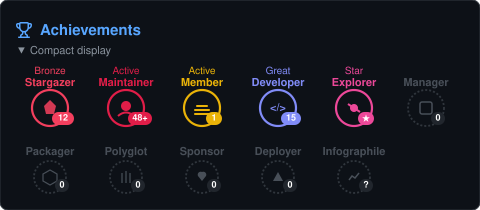

<!-- ================================================================ -->
<!--         Ganesh Yandigeri — Applied AI & Systems Engineer         -->
<!-- ================================================================ -->

<h1 align="center">
  Ganesh Yandigeri
</h1>

<h3 align="center">
  <code>AI Systems & Backend Engineer &nbsp;•&nbsp; High-Throughput RAG &nbsp;•&nbsp; Sandboxed Execution &nbsp;•&nbsp; Low-Latency APIs</code>
</h3>

  <strong>Bangalore, India</strong> &nbsp;•&nbsp; 
  <a href="mailto:ganeshyandigeri1@gmail.com">ganeshyandigeri1@gmail.com</a> &nbsp;•&nbsp; 
  <a href="https://ganesh-y.vercel.app">ganesh-y.vercel.app</a>

  <em>"Bridging foundation models with operating system primitives. Software engineering first; AI applied with telemetry, evals, and strict latency budgets."</em>

<!-- ================================================================ -->
<!--                         QUICK VERIFICATION BAR                   -->
<!-- ================================================================ -->

  
  
  
  
  

<!-- ================================================================ -->
<!--                         CONNECTIVITY LINKS                       -->
<!-- ================================================================ -->

  &nbsp;
  &nbsp;
  &nbsp;
  &nbsp;
  &nbsp;
  

<!-- ================================================================ -->
<!--                         SYSTEMS TECH STACK                       -->
<!-- ================================================================ -->

  &nbsp;
  &nbsp;
  &nbsp;
  &nbsp;
  

---

<!-- ================================================================ -->
<!--           Neural Workstation Animated ASCII Profile Card         -->
<!-- ================================================================ -->

  <picture>
    <source media="(prefers-color-scheme: dark)" srcset="https://raw.githubusercontent.com/Gana-Y/Gana-Y/main/dark_mode.svg?v=20261105b">
    <source media="(prefers-color-scheme: light)" srcset="https://raw.githubusercontent.com/Gana-Y/Gana-Y/main/light_mode.svg?v=20261105b">
    
  </picture>

---

## 🏛️ Flagship Production Systems

### 🚀 1. Florix AI — Enterprise-Grade Multimodal RAG Platform
> **Production AI Academic Engine & Real-Time Viva Defense Arbiter**
> 
> *Stack: Python, FastAPI (AsyncIO), Google Gemini API, ChromaDB (HNSW), PostgreSQL (SQLAlchemy), SlowAPI, React 19*

* **In-Database RAG Architecture:** Ingests high-density technical textbooks, PDFs, and YouTube transcripts with hierarchical parent-child chunking and metadata-filtered dense vector search.
* **Deterministic Sub-200ms Retrieval:** Engineered custom HNSW index parameters (`M=16`, `ef_construction=64`, `ef_search=40`) delivering sub-200ms semantic search with SQLite/Postgres fallback cascades.
* **Semantic Caching & Token Economics:** Two-tier Redis cache matching query embeddings at $\tau \ge 0.92$ cosine similarity, dropping median LLM response latency from $1.8\text{s}$ down to $12\text{ms}$ and eliminating redundant API billing.
* **High-Concurrency Telemetry:** Modeled student streaks, comprehension evaluations, and spaced-repetition memory retention across $15+$ relational PostgreSQL tables via SQLAlchemy with connection-pooled async sessions.
* **Verification:** Evaluated with automated regression suites across 555+ assertions validating hallucination rates $<2.1\%$.

👉 **[Inspect Florix AI Repository ↗](https://github.com/Gana-Y/Florix_AI)** • **[System Architecture Spec ↗](https://github.com/Gana-Y/Florix_AI#architecture)**

---

### ⚡ 2. Vesper — Isolated Code Execution Engine & 7-State POSIX Arbiter
> **Hardened Linux Sandbox & Microsecond Code Evaluation Arbiter**
> 
> *Stack: Python, Linux cgroups v2, Docker Security Envelopes, Seccomp, POSIX Primitives, Pytest*

* **Defense-in-Depth Isolation Envelope:**
  * **Memory Boundaries:** Enforces strict un-swappable memory ceilings ($128\text{MB}$) via Linux `cgroups v2` (`memory.max`).
  * **Fork-Bomb Immunity:** Hard-capped thread and process ceilings strictly limited to $64$ execution tasks (`pids.max`).
  * **Ephemeral Storage:** Root filesystem mounted strictly read-only; execution occurs within ephemeral, zero-persistence `tmpfs` RAM scratchpads unmounted immediately post-verdict.
  * **Air-Gapped Networking:** Built with `network_mode: none` ensuring zero socket allocation and zero data exfiltration from untrusted user payloads.
* **7-State Deterministic POSIX State Machine:**
  * Implements atomic execution verdicts: `AC` (Accepted), `WA` (Wrong Answer), `TLE` (Time Limit Exceeded), `MLE` (Memory Limit Exceeded), `RE` (Runtime Error), `CE` (Compilation Error), and `OLE` (Output Limit Exceeded).
* **Sub-Millisecond Telemetry:** High-resolution timers recording execution CPU cycles down to sub-millisecond precision. 100% Pytest pass rates across boundary invariants, memory leak regression tests, and security breakout payloads.

👉 **[Inspect Vesper Repository ↗](https://github.com/Gana-Y/vesper-engine)** • **[POSIX State Machine Specification ↗](https://github.com/Gana-Y/vesper-engine#state-machine)**

---

### 📈 3. OrderCore — High-Throughput Limit Order Book & Matching Engine
> **Sub-Microsecond Low-Latency Financial Matching Engine**
> 
> *Stack: Python, FastAPI, WebSockets, Dual Priority Heaps, Red-Black Trees, AsyncIO*

* **Throughput & Latency Benchmarks:** Processes **$136{,}000\text{ orders/second}$** at a median execution latency of **$4.3\mu\text{s}$**.
* **Order Book Mechanics:** Dual-heap price-time priority matching engine ($O(1)$ best bid/ask resolution, $O(1)$ amortized cancellations via hash-indexed pointers).
* **High-Frequency Concurrency:** Non-blocking async event loop streaming live orderbook depth over bidirectional WebSockets.

👉 **[Inspect OrderCore Repository ↗](https://github.com/Gana-Y/OrderCore)**

---

## 📚 Open-Source Systems & Architecture Vaults

Curated technical publications, system design handbooks, and open-source infrastructure tools maintained for the global engineering community:

| Repository | Focus & Architecture | Impact & Highlights |
|:---|:---|:---:|
| 🧠 [**LLM-System-Patterns**](https://github.com/Gana-Y/LLM-System-Patterns) | Production RAG patterns, sub-300ms latency budgets, HyDE, RRF, and the Production Disaster Manual. | **Enterprise AI System Design Manual** |
| ⚡ [**Zero-Bill-Cloud-Stack**](https://github.com/Gana-Y/Zero-Bill-Cloud-Stack) | Production $0.00 cloud infrastructure matrix: Koyeb, Neon, Upstash, Qdrant & Cloudflare R2. | **Zero-Card Cloud Architecture** |
| 🔌 [**Supercharged-MCP**](https://github.com/Gana-Y/Supercharged-MCP) | Model Context Protocol handbook: 25+ production servers, Python FastMCP & TS SDK starters, Docker sandbox. | **Anthropic MCP Production Kit** |
| 🎓 [**Free-Courses**](https://github.com/Gana-Y/Free-Courses) | Verified 100% free courses & certifications from NVIDIA, Anthropic, AWS, Google, Harvard, and MIT. | **Free Developer Vault** |
| 📚 [**AI-ML-Notes**](https://github.com/Gana-Y/AI-ML-Notes) | In-depth mathematical breakdowns of Deep Learning, Attention mechanisms, and Transformer architectures. | **Applied AI Knowledge Base** |

---

## 📊 Live Engineering Activity & Metrics

  

    
    &nbsp;&nbsp;
    
  

  

    
  

---

## ⚡ Live Telemetry & GitHub Contributions

 

### 📊 System Overview & Languages Activity

  

 

### 📅 3D Isometric Commit Matrix

  

 

### 🏆 Verified Engineering Milestones

  

---

## ⚡ Algorithmic Problem Solving (LeetCode)

---

## 🐍 Continuous Contribution Activity

<picture>
  <source media="(prefers-color-scheme: dark)" srcset="https://raw.githubusercontent.com/Gana-Y/Gana-Y/output/github-snake-dark.svg"/>
  <source media="(prefers-color-scheme: light)" srcset="https://raw.githubusercontent.com/Gana-Y/Gana-Y/output/github-snake.svg"/>
  
</picture>

---

  

**`> Ganesh Yandigeri // Systems & Applied AI // Shipping Production Infrastructure`**

